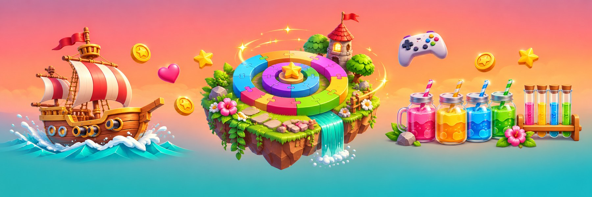
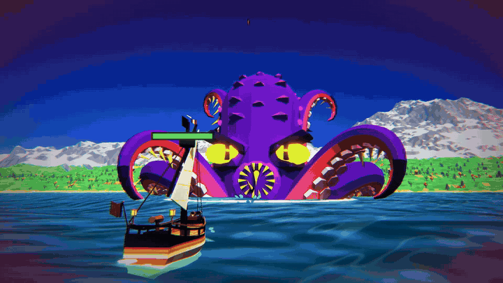
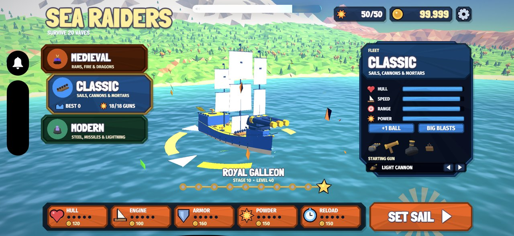
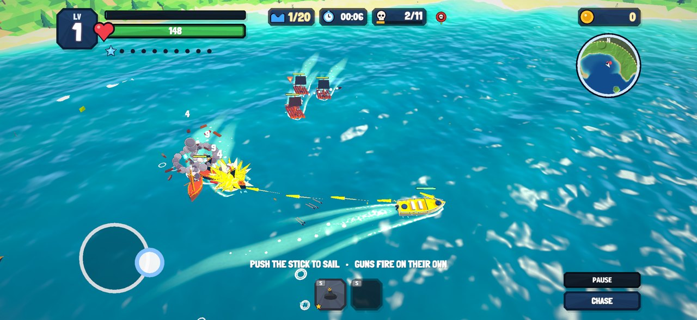
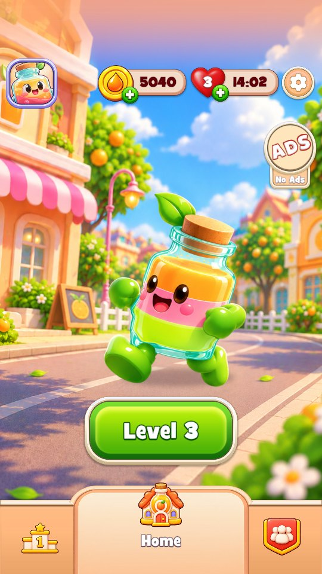
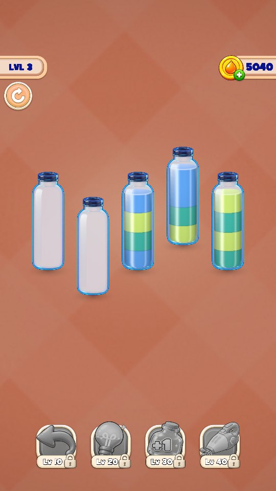
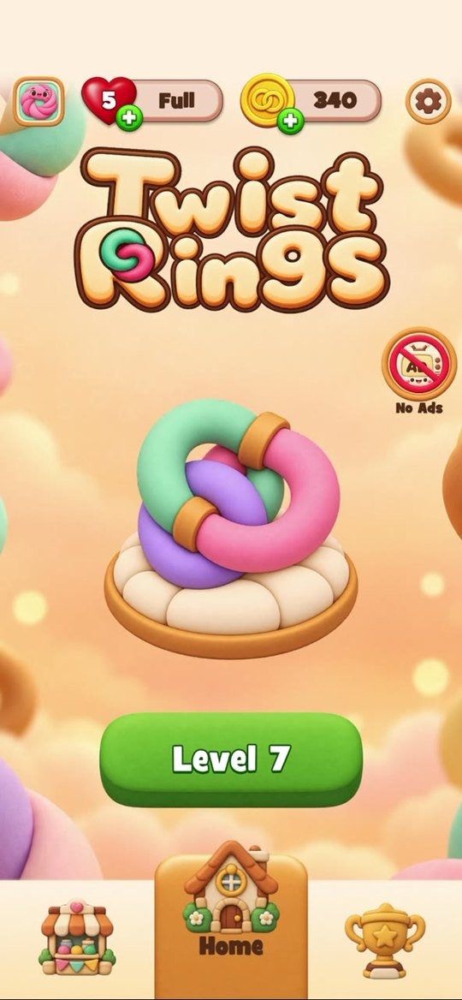
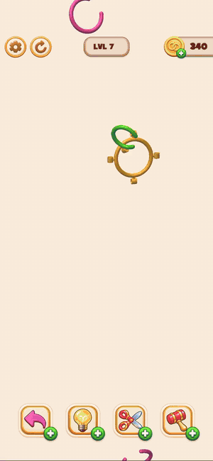

  

<h1 align="center">Hi, I'm Nguyễn Huy Hoàng 👋</h1>

  

  
  
  
  
  
  
  
  

  
  
  

---

## 🎮 About me

I build mobile games in **Unity**, and I build them **AI-first**: I direct a team of **Claude Code agents** that write the C#, run the tests, capture the screens and review each other's work, while I own the design, the game feel and the final call. From the first prototype to the store build: gameplay, juicy feedback, UI, ads and analytics.

> 🇻🇳 Mình là Hoàng, dev game mobile ở **Beng Studio**. Mình làm game Unity theo kiểu **AI-first**: chỉ huy các AI agent (Claude Code) viết code, chạy test, chụp màn hình, tự review; mình lo thiết kế, cảm giác chơi và quyết định cuối. Thích game nhỏ mà chơi "đã tay".

- 🔭 **Now building:** Sea Survival, a naval roguelite with huge boss fights
- 🤖 **How I work:** AI agents for code, tests and tools; GPT for art; ElevenLabs for sound; Blender for low-poly 3D
- 🧩 **Love making:** puzzle mechanics, game feel, VFX, low-poly 3D art
- 📱 **Ships to:** Android ([Google Play](https://play.google.com/store/apps/dev?id=8287384967268227703)) and iOS
- 🛒 **My store:** [BengStudio on Google Play](https://play.google.com/store/apps/dev?id=8287384967268227703), growing: first apps are live, games are on the way 🚧
- 📫 **Find me on:** [Facebook](https://www.facebook.com/home.come.908/) · [LinkedIn](https://www.linkedin.com/in/ho%C3%A0ng-nguy%E1%BB%85n-14ab7126b)

---

## 🤖 AI-native game dev

<table>
  <tr>
    <td width="50%" valign="top">
      <h4>🧠 Agents write the code</h4>
      <ul>
        <li><b>Claude Code</b> agents and sub-agents build features end to end in Unity C#</li>
        <li>Multi-agent workflows: parallel reviewers, fixers and verifiers</li>
        <li>Every project carries its own <code>CLAUDE.md</code> / <code>AGENTS.md</code> and an <code>.ai/</code> knowledge base (decisions, rules, known issues, tasks)</li>
        <li>Custom <b>skills</b> for the studio's way of working: iOS builds, rip-and-remake, audio, art</li>
      </ul>
    </td>
    <td width="50%" valign="top">
      <h4>🧪 Agents test and verify</h4>
      <ul>
        <li>Unity batch mode in a shadow copy, so agents compile and test while the Editor stays open</li>
        <li>Data-driven UI flow tests that tap through the real game and write an HTML report with screenshots</li>
        <li>Capture tools and balance simulators that play the game headless</li>
        <li>Agents take a change all the way to a build running on a real iPhone</li>
      </ul>
    </td>
  </tr>
  <tr>
    <td width="50%" valign="top">
      <h4>🎨 AI makes the assets</h4>
      <ul>
        <li><b>GPT image</b> for sprites, icons, UI, key art (this banner too)</li>
        <li><b>ElevenLabs</b> for sound effects and voice-over</li>
        <li><b>Seedance</b> image-to-video for animated scenes</li>
        <li><b>Blender</b> driven by Python and MCP for low-poly 3D models</li>
      </ul>
    </td>
    <td width="50%" valign="top">
      <h4>🔌 Tools wired in with MCP</h4>
      <ul>
        <li>Blender, Figma, Google Sheets and Docs connected straight to the agents</li>
        <li>Promo videos and ad cuts rendered from code</li>
        <li>Balance and monetisation dashboards the team can edit live</li>
      </ul>
    </td>
  </tr>
</table>

> 🇻🇳 Mình không chỉ "dùng AI để hỏi". AI agent là đồng đội: viết code, viết test, tự chạy game kiểm tra, vẽ asset, làm âm thanh. Mình đóng vai game designer và tech lead.

---

## 🕹️ Games I've built

  

> 🚧 **The BengStudio store on Google Play is growing.** The first apps are live, and the games below are on their way to the store. [Follow the store](https://play.google.com/store/apps/dev?id=8287384967268227703) to catch every launch!
>
> 🇻🇳 Store **BengStudio** trên Google Play đang phát triển: đã có những app đầu tiên, các game bên dưới đang trên đường lên kệ. [Theo dõi store](https://play.google.com/store/apps/dev?id=8287384967268227703) để chơi sớm nhé!

### 🏴‍☠️ Sea Survival (working title: Sea Raiders)

  

**Just steer, the guns fire on their own.** Survive 20 waves, pick new guns every level, evolve your ship from a fishing boat to a royal galleon and sink giant bosses: Kraken Titan, Elder Sea Dragon and more. Three fleets: Medieval, Classic and Modern.

> 🇻🇳 Game hải chiến roguelite: chỉ cần lái, súng tự bắn. Sống sót 20 đợt, nâng cấp tàu, đánh boss khổng lồ.

  
  

<table>
  <tr>
    <th width="50%">🧃 Juice Sort</th>
    <th width="50%">💍 Twist Rings</th>
  </tr>
  <tr>
    <td align="center">
      
      
    </td>
    <td align="center">
      
      
    </td>
  </tr>
  <tr>
    <td>
      A cosy sort puzzle: pour layered juice until every bottle holds one flavour. Boosters, hard levels with a move limit, an animated jar mascot and juicy popups.
       🇻🇳 Game xếp nước ép theo màu, có booster, màn khó giới hạn lượt và mascot hũ nước biết nhảy.
    </td>
    <td>
      A 3D untangle puzzle: twist rings and slide bars until every piece falls free. Locks and keys, ice, a scissors booster and hand-built showcase levels with up to 35 rings.
       🇻🇳 Game giải đố 3D: xoay vòng, rút thanh để gỡ từng mảnh. Có khóa và chìa, băng, booster kéo.
    </td>
  </tr>
</table>

---

## 🛠️ Tech stack

  

  
  
  
  
  
  
  

  
  
  
  
  
  

---

## 📫 Let's connect

  
  
  

Want to talk games, Unity or AI agents? Message me on Facebook or connect on LinkedIn. 🇻🇳 Muốn nói chuyện về game, Unity hay AI agent thì nhắn mình qua Facebook hoặc kết nối LinkedIn nhé.

---

  <i>Making games that feel good in one thumb. Thanks for stopping by! 🌊</i> 
  <i>Cảm ơn bạn đã ghé chơi!</i> 
  🤖 This profile, banner included, was put together with Claude Code and GPT image.

